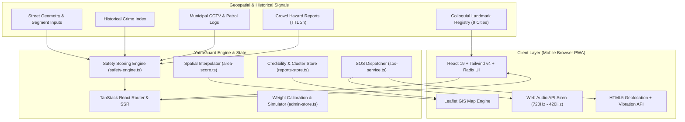

# 🛡️ YatraGuard (यात्रा गार्ड)

> **Intelligent Safety-Centric Urban Navigation & Emergency Response System**  
> _Safest route, every time. Context-aware urban mobility built for Indian cities._

[](https://github.com/anandversespace-debug/YatraGuard)
[](https://react.dev/)
[](https://www.typescriptlang.org/)
[](https://tanstack.com/router)
[](https://tailwindcss.com/)
[](https://leafletjs.com/)
[](LICENSE)
[](https://github.com/anandversespace-debug/YatraGuard)
[](https://github.com/anandversespace-debug/YatraGuard)

> [!IMPORTANT]
> **⚠️ PROTOTYPE REPOSITORY NOTICE**
>
> - **Prototype Only:** This repository represents **strictly the experimental prototype and proof-of-concept (PoC)** for YatraGuard.
> - **Not Deployed:** This prototype is **not deployed to production**; it is designed for local simulation, UI validation, and safety scoring engine demonstrations.
> - **Main Project in Development:** The comprehensive, full-scale production application is **being built separately in another repository**.

---

## 📖 Executive Summary

Urban mobility in rapidly growing metropolitan and Tier-2 Indian cities poses severe personal safety challenges—disproportionately impacting **women, university students, healthcare workers, late-night shift employees, and vulnerable commuters**.

Conventional navigation platforms (such as Google Maps or Apple Maps) optimize almost exclusively for **travel duration and geometric distance**. In doing so, they frequently route commuters through unlit side streets, isolated underpasses, abandoned bypasses, or historic crime corridors simply because they save 90 seconds.

**YatraGuard** redefines urban routing by treating **human safety as a first-class optimization objective alongside travel time**. Powered by a deterministic multi-factor **Safety Scoring Engine**, spatial hazard heatmaps, zero-asset emergency SOS alert synthesizers, and crowd-verified incident reporting, YatraGuard empowers commuters with actionable situational awareness and safe passage.

---

## ⚡ Key Highlights & Core Features

### 1. 🧭 Multi-Factor Safety Scoring Engine (`1–100`)

- **Deterministic Segment Evaluation:** Analyzes street segments using weighted physical, environmental, and temporal parameters:
  - 💡 **Street Lighting Coverage** ($0\text{--}100\%$)
  - 👥 **Pedestrian Crowd Density / Footfall** ($0\text{--}100\%$, calibrated for day vs. night)
  - 📹 **CCTV Camera Density** (surveillance presence)
  - 🚔 **Active Police Patrol Proximity** (verified patrols within the past 15 minutes)
  - ⚠️ **Historical Crime Index** (escalated penalties in low-light environments)
  - 🗣️ **Community-Reported Unsafe Incidents**
  - 🌙 **Time-of-Day Dynamic Multipliers** (stricter nocturnal penalties between 8:00 PM and 6:00 AM)
- **Granular Route Breakdown:** Users can inspect the exact signed point impact ($+/\!-$) of lighting, crowd density, CCTV, patrols, crime, and nocturnal penalties per street segment.
- **Weakest Link Detection:** Highlights the single most vulnerable segment along any candidate route (e.g., _"Weakest segment: Industrial cut-through (42/100)"_).

### 2. 🔀 Tri-Strategy Route Optimization

Instead of forcing a single path, YatraGuard generates three distinct routing alternatives:
| Strategy | Objective | Formulation | Best For |
| :--- | :--- | :--- | :--- |
| **🛡️ Safest** | Maximize physical safety | $90\% \text{ Safety Score} + 10\% \text{ Travel Speed}$ | Late night commutes, solo walking, high-risk areas |
| **⚖️ Balanced** | Balance security and transit efficiency | $60\% \text{ Safety Score} + 40\% \text{ Travel Speed}$ | Daily evening transit, mixed commute modes |
| **⚡ Fastest** | Minimize total journey time | $15\% \text{ Safety Score} + 85\% \text{ Travel Speed}$ | Rush hour travel through daylight main boulevards |

### 3. 🗺️ Geospatial Safety Heatmap with Tap-to-Score IDW

- **Interactive Multi-City Heatmap:** Interactive Leaflet GIS visualization featuring colored danger, caution, and safe buffer zones with OKLCH pulsing glow halos.
- **Arbitrary Coordinate Scoring (Inverse Distance Weighting):** Tap **anywhere** on the city map to instantly calculate an interpolated local safety score ($1\text{--}100$) using spatial decay over surrounding known risk zones within a $3\text{ km}$ radius.
- **Tier-1 and Tier-2 Indian City Coverage:**
  - **Tier-1:** Bengaluru (BLR), Hyderabad (HYD), Delhi NCR (DEL)
  - **Tier-2:** Jaipur (JAI), Lucknow (LKO), Indore (IND), Kochi (KCH), Chandigarh (CHD), Bhubaneswar (BBI)

### 4. 📍 Landmark-First Search Architecture

Indian urban navigation rarely relies on precise alphanumeric street addresses. Commuters orient via recognized public landmarks (_"Opposite Big Bazaar"_, _"Near Metro Pillar 142"_, _"Outside Temple West Gate"_). YatraGuard’s built-in landmark registry maps colloquial destinations directly to coordinates across:

- 🚇 **Metro Stations** & 🚆 **Railway Junctions**
- 🚌 **Interstate Bus Terminals (ISBT / Bus Stands)**
- 🛍️ **Markets & Commercial Malls**
- 🛕 **Temples & Cultural Landmarks**
- 🏥 **Hospitals & Universities**

### 5. 🚨 Zero-Asset Emergency SOS System

- **2.5-Second Fail-Safe Hold Trigger:** Prevents accidental pocket triggers through an animated radial SVG progress indicator and haptic feedback.
- **Dual-Tone Synthesized Web Audio Siren:** Generates a real-time $720\text{ Hz} \leftrightarrow 420\text{ Hz}$ frequency-modulated sawtooth wail directly via the browser's `AudioContext`—**requires zero external audio file downloads and works completely offline**.
- **Haptic Vibration API Integration:** Dispatches synchronized tactile pulses (`[300ms, 120ms, 300ms, 120ms, 600ms]`) on supported mobile devices.
- **Live GPS Broadcast & Share Links:** Automatically captures high-accuracy HTML5 GPS coordinates, generates an authenticated tracking link (`yatraguard.link/track/:id`), and provides one-touch WhatsApp & SMS sharing.
- **Emergency Dispatch Queue:** Simulates real-time contact notifications and features a 30-second automated countdown to dispatch local police (Dial 100).
- **Direct Emergency Quick-Dial:** 1-tap connection to **100** (Police), **1091** (Women Helpline), and **108** (Ambulance).

### 6. 🤝 Crowd Hazard Reporting with Credibility Scoring

- **Incident Categorization:** Harassment, Stalking / Being Followed, Theft Risk, Dark Road / Outage, Accident, and Unsafe Gathering.
- **Spatial Clustering ($120\text{ m}$):** Reports occurring within a $120\text{ meter}$ radius of an existing incident automatically merge, boosting verification weight instead of cluttering the UI.
- **Credibility Decay Engine:** Calculates real-time trustworthiness scores based on user confirmations, community disputes, incident severity, and a 2-hour temporal decay model.
- **Auto-Purge & Dispute Elimination:** False or contested reports are automatically dropped if community disputes outweigh confirmations.

### 7. 📶 Lite Mode (Built for 2G/3G & Budget Android Devices)

Designed with the reality of Indian mobile infrastructure in mind:

- Instantly pauses Leaflet raster tile downloads and heavy tile requests.
- Disables GPU-heavy OKLCH backdrops, backdrop-blur filters, and animated halos.
- Retains $100\%$ functionality of mathematical route scoring, offline siren, emergency SOS, and hazard alerts.

### 8. 🎛️ Admin Simulation Console & Traction Analytics

- **Live Safety Weight Calibrator:** Sliders to tune engine weights (lighting boost, crowd weight, CCTV bonus, crime penalty, nocturnal penalty) in real time.
- **24-Hour Time-of-Day Simulator:** Preview how identical streets transition from safe (Day) to high-risk (Night) as the clock advances past 20:00.
- **1,000-User Simulated Cohort Analytics:** Visualizes consumer preference for safe navigation, proving that $>70\%$ of commuters choose the safer path despite slight time trade-offs.

---

## 🏗️ System Architecture



---

## 🧮 Mathematical Formulations

### 1. Road Segment Safety Score ($S_{\text{seg}}$)

Each individual street segment receives an integer score between $1$ and $100$:

$$S_{\text{raw}} = B + \left(\frac{L}{100} \cdot W_L\right) + \left(\frac{C}{100} \cdot W_C \cdot \mu_{\text{night}}\right) + \left(\min\left(1, \frac{\text{cctv}}{8}\right) \cdot W_{\text{cctv}}\right) + (P \cdot W_P) - P_{\text{crime}} - P_{\text{rep}} - P_{\text{night}}$$

Where:

- $B = 30$ (Base score constant)
- $L \in [0, 100]$: Lighting level ($W_L = 25$)
- $C \in [0, 100]$: Pedestrian footfall density ($W_C = 20$)
- $\mu_{\text{night}} = 0.6$ if hour $\ge 20$ or $< 6$, else $1.0$ (crowd after midnight provides less safety protection)
- $\text{cctv}$: Count of street surveillance cameras ($W_{\text{cctv}} = 15$)
- $P \in \{0, 1\}$: Active patrol observed within 15 minutes ($W_P = 10$)
- $P_{\text{crime}} = \left(\frac{\text{CrimeIndex}}{100}\right) \cdot W_{\text{crime}} \cdot \left(1 + \left(1 - \frac{L}{100}\right) \cdot 0.5\right)$ (Crime penalty scales up in poor lighting, $W_{\text{crime}} = 35$)
- $P_{\text{rep}} = \min\left(1, \frac{\text{Reports}}{15}\right) \cdot W_{\text{rep}}$ ($W_{\text{rep}} = 25$)
- $P_{\text{night}} = W_{\text{night}} \cdot \left(1 - \frac{L}{100}\right)$ if night, else $0$ ($W_{\text{night}} = 15$)

The resulting score is clamped:

$$S_{\text{seg}} = \text{clamp}\Big(\text{round}(S_{\text{raw}}),\, 1,\, 100\Big)$$

---

### 2. Route Safety Aggregation ($S_{\text{route}}$)

A candidate route comprising segments $s_1, s_2, \dots, s_n$ with lengths $d_1, d_2, \dots, d_n$ (in km) is evaluated using a **distance-weighted average**:

$$S_{\text{route}} = \text{round}\left(\frac{\sum_{i=1}^n S_{\text{seg}}(s_i) \cdot d_i}{\sum_{i=1}^n d_i}\right)$$

Safety Tiers:

- **🟢 Safe:** $S_{\text{route}} \ge 75$
- **🟡 Moderate:** $55 \le S_{\text{route}} < 75$
- **🔴 Risky:** $S_{\text{route}} < 55$

---

### 3. Spatial Inverse Distance Weighting (IDW) for Arbitrary Coordinates

When a user taps any point $p$ on the map, surrounding known hotspots within a $3\text{ km}$ radius contribute to the interpolated score:

$$w_i = \frac{1}{(d(p, z_i) + 0.15)^{1.6}}$$

$$S_{\text{interpolated}} = \frac{\sum_{i=1}^k w_i \cdot \text{BaseTier}(z_i)}{\sum_{i=1}^k w_i} - \Delta_{\text{night}}$$

Where $d(p, z_i)$ is computed via the Haversine formula, and $\Delta_{\text{night}} = 8$ if nighttime.

---

### 4. Community Report Credibility Score ($C_{\text{rep}}$)

$$C_{\text{rep}} = \min\left(100,\, \text{round}\Big(\big(\max(0, \text{Upvotes} - \text{Disputes}) \times 14 + \text{Severity} \times 8\big) \times \max\left(0.3,\, 1 - \frac{\text{Age}_{\text{minutes}}}{120}\right)\Big)\right)$$

- **Credibility Tiers:** $\text{High } (\ge 65) \;\vert\; \text{Medium } (35\text{--}64) \;\vert\; \text{Low } (< 35)$
- **Time-to-Live (TTL):** Default $2\text{ hours}$; confirming an alert extends TTL by $30\text{ minutes}$.

---

## 🛠️ Technology Stack

| Layer                       | Technologies                                                                                                                    |
| :-------------------------- | :------------------------------------------------------------------------------------------------------------------------------ |
| **Frontend Framework**      | [React 19](https://react.dev/) (`^19.2.0`), [TypeScript](https://www.typescriptlang.org/) (`^5.8.3`)                            |
| **Routing & SSR**           | [TanStack React Router](https://tanstack.com/router) (`^1.168.0`), [TanStack React Start](https://tanstack.com/start)           |
| **Styling & Design System** | [Tailwind CSS v4](https://tailwindcss.com/) (`^4.2.1`), OKLCH Color Space, Glassmorphism, CSS Custom Properties                 |
| **UI Component Primitives** | [Radix UI](https://www.radix-ui.com/) (Accordion, Dialog, Popover, Slider, Switch, Tooltip, Tabs)                               |
| **Mapping & Geospatial**    | [Leaflet](https://leafletjs.com/) (`^1.9.4`), [React-Leaflet](https://react-leaflet.js.org/) (`^5.0.0`), Haversine Spatial Math |
| **Icons & Typography**      | [Lucide React](https://lucide.dev/), Google Fonts (_Inter_, _Space Grotesk_)                                                    |
| **Hardware Browser APIs**   | Web Audio API (`AudioContext`), HTML5 Geolocation API, Web Vibration API, Clipboard API                                         |
| **Build & Tooling**         | [Vite 8](https://vitejs.dev/) (`^8.3.5`), [Bun](https://bun.sh/) / npm, ESLint 9, Prettier                                      |
| **Edge Serverless Ready**   | [Cloudflare Workers](https://workers.cloudflare.com/) / Pages (`@cloudflare/vite-plugin`, `wrangler.jsonc`)                     |

---

## 📁 Repository Structure

```
yatra-safe-routes-main/
├── YatraGuard_Abstract.pdf      # Formal system abstract & specification document
├── wrangler.jsonc               # Cloudflare Pages / Workers deployment manifest
├── vite.config.ts               # Vite configuration with TanStack & Tailwind
├── tsconfig.json                # TypeScript project configuration
├── package.json                 # Project dependencies and script declarations
├── src/
│   ├── router.tsx               # TanStack router initialization & error boundary
│   ├── routeTree.gen.ts         # Generated route tree
│   ├── styles.css               # OKLCH design tokens, theme variables & animations
│   ├── components/
│   │   ├── ui/                  # Radix UI wrapper primitives (button, dialog, etc.)
│   │   └── yatra/               # YatraGuard domain-specific components
│   │       ├── BottomNav.tsx            # Sticky mobile bottom navigation bar
│   │       ├── ClientOnly.tsx           # SSR hydration-safe wrapper
│   │       ├── EmergencyContactList.tsx # Emergency circle manager with localStorage
│   │       ├── LandmarkSearchSheet.tsx  # Landmark search drawer with category icons
│   │       ├── PhoneShell.tsx           # Responsive mobile frame wrapper
│   │       ├── ReportSheet.tsx          # 140-char crowd hazard reporting sheet
│   │       ├── SafetyMap.tsx            # Leaflet dynamic map wrapper
│   │       └── SafetyMapInner.tsx       # Leaflet markers, pulse rings & polyline renderers
│   ├── hooks/
│   │   └── use-mobile.tsx       # Responsive viewport hook
│   ├── lib/
│   │   ├── admin-store.ts       # Real-time weight sliders, time-of-day & simulator state
│   │   ├── analytics-store.ts   # Event logging & 1,000-user cohort traction analytics
│   │   ├── area-score.ts        # Haversine spatial math & IDW coordinate interpolation
│   │   ├── cities.ts            # 9 Indian cities (Tier 1 & 2), hotspots & landmark DB
│   │   ├── destination-store.ts # Session destination transfer store
│   │   ├── lite-mode.ts         # 2G/3G low-data mode toggle & state
│   │   ├── mock-data.ts         # Fallback coordinates, contacts, alerts, quick-dial
│   │   ├── reports-store.ts     # Crowd hazard store, cluster merge & credibility engine
│   │   ├── route-segments.ts    # Multi-route road segments (100ft, Defence Colony, Shortcut)
│   │   ├── safety-engine.ts     # Pure mathematical segment & route scoring engine
│   │   ├── sos-service.ts       # Web Audio dual-tone siren, GPS, haptics & SMS dispatch
│   │   └── utils.ts             # Tailwind class merging utility (clsx + twMerge)
│   └── routes/
│       ├── __root.tsx           # Root HTML layout with Google Fonts & meta tags
│       ├── index.tsx            # Home: Area safety score (86/100), quick destinations
│       ├── navigate.tsx         # Route selection: Safest vs Balanced vs Fastest, 24h slider
│       ├── heatmap.tsx          # City-wide risk heatmap, tap-to-score, city switcher
│       ├── sos.tsx              # Emergency SOS: 2.5s hold, wailing siren, WhatsApp link
│       ├── alerts.tsx           # Live crowd reports & official feeds with upvote/dispute
│       ├── admin.tsx            # Live weight tuning sandbox & automated incident injector
│       ├── metrics.tsx          # Traction metrics, route split KPIs & 14-day chart
│       └── profile.tsx          # User safety profile, night mode boost, lite mode
```

---

## 🚀 Getting Started

### Prerequisites

- **Node.js** (v20.x or higher) or **Bun** (v1.1 or higher)
- **npm**, **pnpm**, or **bun**

### 1. Clone the Repository

```bash
git clone https://github.com/anandversespace-debug/YatraGuard.git
cd YatraGuard
```

### 2. Install Dependencies

```bash
npm install
# or if using Bun:
bun install
```

### 3. Run Development Server

```bash
npm run dev
# or
bun dev
```

Open [http://localhost:3000](http://localhost:3000) (or the port displayed in your terminal) in your browser.

> **💡 Mobile Testing Tip:** Open Chrome DevTools and switch to a mobile device viewport (e.g., iPhone 15 Pro, Pixel 7) or load the IP on your mobile device connected to the same Wi-Fi network for the best native app experience.

---

## 💻 Available Scripts

| Command             | Action                                                         |
| :------------------ | :------------------------------------------------------------- |
| `npm run dev`       | Starts the Vite development server with hot module replacement |
| `npm run build`     | Builds the production bundle (with Cloudflare SSR entry)       |
| `npm run build:dev` | Builds the project in development mode for debugging           |
| `npm run preview`   | Previews the local production build                            |
| `npm run lint`      | Runs ESLint across the codebase                                |
| `npm run format`    | Runs Prettier to auto-format code across all files             |

---

## 🌐 Deployment Architecture (Reference)

> **Note:** This repository is **not deployed to production**. The project runs locally for testing and demonstration. The setup below outlines the Cloudflare Workers / Pages edge architecture configured for the application:

1. **Edge Entry Manifest (`wrangler.jsonc`):**
   ```jsonc
   {
     "name": "yatraguard",
     "compatibility_date": "2025-09-24",
     "compatibility_flags": ["nodejs_compat"],
     "main": "@tanstack/react-start/server-entry",
   }
   ```
2. **Build and Local Preview:**
   ```bash
   npm run build
   npm run preview
   ```

---

## 📱 Interactive Walkthrough & Testing Scenarios

| Scenario                          | Steps to Experience                                                                                                                                                                                                                  |
| :-------------------------------- | :----------------------------------------------------------------------------------------------------------------------------------------------------------------------------------------------------------------------------------- |
| **Compare Route Options**         | 1. Navigate to `/navigate`<br>2. Toggle between **Safest**, **Balanced**, and **Fastest**<br>3. Inspect the safety bar, lighting %, and CCTV coverage<br>4. Expand _"Why score XX?"_ to view individual street segment contributions |
| **Simulate Nighttime Transition** | 1. In `/navigate`, drag the **Simulated Time** slider from `14:00` (Day) to `23:00` (Night)<br>2. Watch scores automatically recalculate as night penalties apply to unlit segments                                                  |
| **Tap-to-Score on Map**           | 1. Navigate to `/heatmap`<br>2. Select any city (e.g., Bengaluru, Jaipur, Lucknow)<br>3. Tap any street or neighborhood on the map to trigger spatial IDW scoring                                                                    |
| **Emergency SOS Siren & Haptics** | 1. Go to `/sos`<br>2. Hold the red SOS button for **2.5 seconds**<br>3. Observe Web Audio dual-tone siren wail, vibration pulse, GPS resolution, and generated WhatsApp tracking message                                             |
| **Crowd Verification**            | 1. Go to `/alerts`<br>2. Tap **Report** to log a hazard (e.g., "Dark road")<br>3. Use **Confirm** / **Dispute** buttons to watch credibility score adjust in real time                                                               |
| **Admin Weight Calibration**      | 1. Open `/admin`<br>2. Adjust the **Crime Penalty** or **Lighting Boost** sliders<br>3. Return to `/navigate` to see all route rankings adjust dynamically                                                                           |

---

## 👥 Team — Syntax Squad

Developed with dedication by **Syntax Squad**:

| Role            | Name           |
| :-------------- | :------------- |
| **Team Lead**   | **Anand Babu** |
| **Team Member** | Hemanth        |
| **Team Member** | Veni Kaustubha |
| **Team Member** | Joshik         |
| **Team Member** | Venkatesh Naik |

---

## ⚖️ Safety & Ethical Disclaimer

> **IMPORTANT NOTICE:**  
> YatraGuard is designed as an intelligent decision-support tool to encourage situational awareness and risk-informed route selection. Safety scores are calculated based on available statistical, physical, environmental, and community-reported indicators. **Risk scores provide guidance and cannot guarantee personal safety or prevent criminal acts.** In any immediate emergency, users should always dial official emergency services (**100 / 112** in India) or seek immediate public assistance.

---

## 📄 License

This project is licensed under the **MIT License**. Feel free to use, modify, and distribute this codebase for research, civic tech, and educational purposes.

---

<div align="center">
  <sub>Built with ❤️ by <b>Syntax Squad</b> for safer Indian streets and confident commuter journeys.</sub><br>
  <sub><b>YatraGuard</b> — Safe navigation, community resilience, and rapid emergency response.</sub>
</div>
